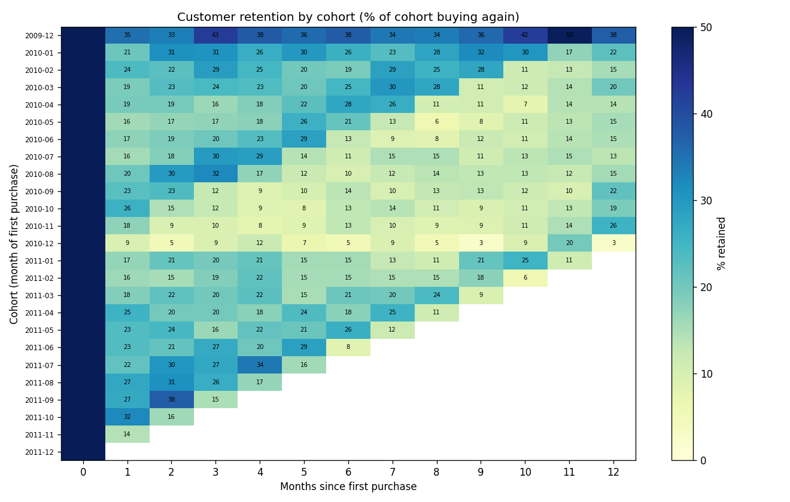

# E-commerce Product Analytics

Customer and product analytics on ~1M real transactions from a UK online retailer (Online Retail II, 2009-2011),
plus a full A/B test analysis on a real mobile-game experiment (Cookie Cats, ~90K players): data-quality checks,
monthly KPIs, cohort retention, RFM customer segmentation, and A/B testing with significance, confidence intervals,
sample-ratio-mismatch and power checks.

**Report:** [reports/analytics_report.md](reports/analytics_report.md)



## Key results
- 1.07M raw invoice lines cleaned to 779K (27% removed: cancellations, missing customers, invalid prices, duplicates); 36,969 orders from 5,878 customers, Dec 2009 - Dec 2011.
- 72% of customers ordered more than once; about 21% of each cohort buys again in a given later month.
- The top 20% of customers bring 77% of revenue; Champions are 25% of customers and 69% of revenue.
- A/B test (90,189 players): moving the gate from level 30 to 40 cut 7-day retention by 0.82 pp (p = 0.0016); 1-day effect inconclusive (below the 0.93 pp detectable effect); sample-ratio mismatch flagged (p = 0.009), so assignment should be checked. Recommendation: keep the gate at level 30.

## What it does
1. **Data quality** (`src/prepare.py`): removes cancellations, lines without a customer, non-positive quantities or
   prices and duplicates, and counts each in `outputs/data_quality.csv`.
2. **KPIs** (`src/metrics.py`): monthly revenue, orders, active and new customers, average order value, orders per customer.
3. **Cohort retention**: customers grouped by month of first order; share buying again in each later month.
4. **RFM segmentation**: recency, frequency and monetary scores (1-5 by quintile) → Champions, Loyal, Potential loyalists,
   New, At risk, Hibernating, Needs attention; revenue concentration (top 20% of customers).
5. **A/B test** (`src/abtest.py`): sample ratio mismatch (chi-square), two-proportion z-test with 95% confidence
   interval, bootstrap interval, minimum detectable effect at 80% power, and a Mann-Whitney test on the skewed
   guardrail metric (game rounds).
6. **Charts and report** (`src/charts.py`, `run.py`), **tests** (`tests/`), and a **GitHub Actions** run on every push.

## Run it yourself
```bash
python3.11 -m venv .venv
source .venv/bin/activate
pip install -r requirements.txt
pytest -q
python3 run.py
```
The retail file downloads automatically from UCI. Download `cookie_cats.csv` from Kaggle
("Mobile Games A/B Testing") into `data/raw/`.

## Data
- Online Retail II: UCI Machine Learning Repository (Chen, 2019), CC BY 4.0.
- Cookie Cats A/B test: Kaggle, "Mobile Games A/B Testing".
Raw files are not committed; the cleaned parquet and A/B CSV are, so the analysis reruns in CI.
