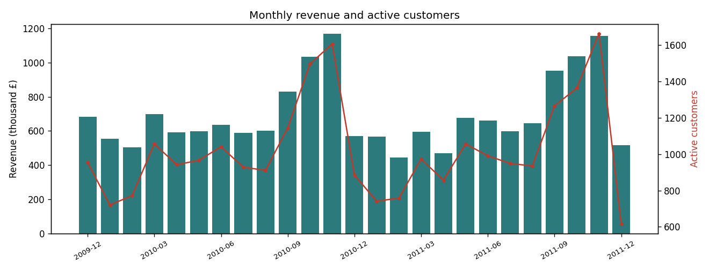
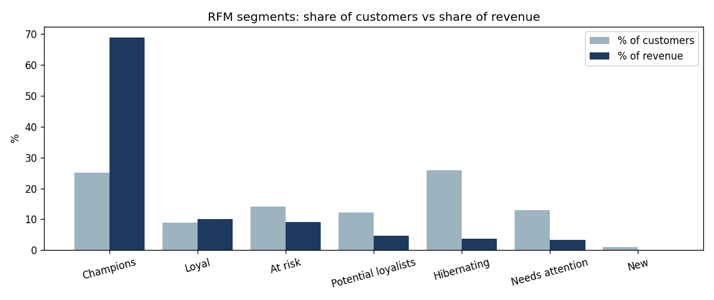
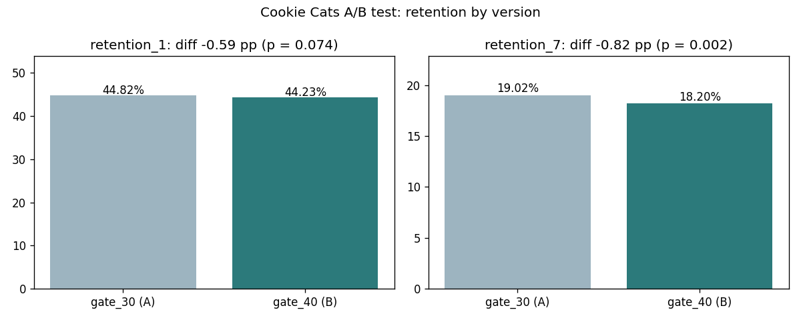

# E-commerce Product Analytics Report

## 1. Key findings
- 779,425 clean order lines, 36,969 orders, 5,878 customers, 2009-12 to 2011-12; total revenue £17,374,804.
- Average order value £470; 72.4% of customers ordered more than once.
- Cohort retention: on average 21.2% of a cohort buys again in month 1 and 21.6% in month 3.
- The top 20% of customers bring 77.2% of revenue; 'Champions' is the biggest segment by revenue (69.0% of revenue from 25.1% of customers).
- A/B split: 44,700 vs 45,489 users (SRM p = 0.0086, mismatch flagged).
- 7-day retention: 19.02% (gate 30) vs 18.20% (gate 40), diff -0.82 pp, 95% CI [-1.33, -0.31], p = 0.0016.
- 1-day retention: diff -0.59 pp, p = 0.0744; minimum detectable effect at this sample size ≈ 0.93 pp.
- Guardrail (game rounds): median 17 vs 16, Mann-Whitney p = 0.0502; max rounds by one user = 49,854; the metric is heavily skewed, so medians are compared, not means.

### Analyst commentary
<!-- COMMENTARY -->
Revenue is highly concentrated: the top 20% of customers bring 77% of revenue, and the Champions segment alone gives 69% of revenue from 25% of customers, so retaining a small group of large, mostly wholesale buyers matters most. Customers return often (72% ordered more than once), but only about 21% of a cohort buys again in any given later month, so lifting month-1 repeat purchase is the clearest lever. In the A/B test, moving the first gate from level 30 to 40 cut 7-day retention by 0.82 points (19.02% to 18.20%, 95% CI -1.33 to -0.31, p = 0.0016), while the 1-day effect was inconclusive because it is smaller than what this sample can reliably detect (0.93 points). The groups were slightly unbalanced (49.6% vs 50.4%, sample-ratio p = 0.009), so I would check how users were assigned before treating the result as final. Recommendation: keep the gate at level 30, and target at-risk former Champions with win-back offers.
<!-- COMMENTARY -->

## 2. Data quality
1,067,371 raw lines → 779,425 clean (26.98% removed).

| rule | rows | pct_of_raw |
| --- | --- | --- |
| cancellations | 19494 | 1.83 |
| missing_customer | 243007 | 22.77 |
| bad_quantity_or_price | 25700 | 2.41 |
| duplicates | 34335 | 3.22 |

## 3. Monthly KPIs (last 6 months)
| month | revenue | orders | active_customers | new_customers | aov | new_customer_share |
| --- | --- | --- | --- | --- | --- | --- |
| 2011-07 | 598962.9 | 1331 | 949 | 102 | 450.01 | 0.11 |
| 2011-08 | 644051.04 | 1280 | 935 | 106 | 503.16 | 0.11 |
| 2011-09 | 950690.2 | 1755 | 1266 | 189 | 541.7 | 0.15 |
| 2011-10 | 1035642.45 | 1929 | 1364 | 221 | 536.88 | 0.16 |
| 2011-11 | 1156205.61 | 2657 | 1664 | 191 | 435.15 | 0.11 |
| 2011-12 | 517208.44 | 778 | 615 | 28 | 664.79 | 0.05 |

## 4. Cohort retention

## 5. RFM segments
| segment | customers | customer_share | revenue_share | avg_orders | avg_recency_days |
| --- | --- | --- | --- | --- | --- |
| Champions | 1473 | 0.251 | 0.69 | 15.692 | 20.131 |
| Loyal | 524 | 0.089 | 0.1 | 8.565 | 105.324 |
| At risk | 825 | 0.14 | 0.092 | 4.942 | 368.882 |
| Potential loyalists | 711 | 0.121 | 0.047 | 2.592 | 25.616 |
| Hibernating | 1526 | 0.26 | 0.038 | 1.253 | 458.75 |
| Needs attention | 765 | 0.13 | 0.033 | 1.935 | 98.596 |
| New | 54 | 0.009 | 0.001 | 1.0 | 10.5 |

## 6. A/B test: Cookie Cats (gate at level 30 vs 40)
Sample ratio check: 44,700 vs 45,489 (A share 49.56%), chi-square p = 0.0086.

| metric | control_gate_30 | treatment_gate_40 | diff_pp | ci_95_pp | bootstrap_ci_pp | p_value | mde_pp | significant |
| --- | --- | --- | --- | --- | --- | --- | --- | --- |
| retention_1 | 44.82 | 44.23 | -0.59 | [-1.24, 0.06] | [-1.26, 0.03] | 0.0744 | 0.93 | False |
| retention_7 | 19.02 | 18.2 | -0.82 | [-1.33, -0.31] | [-1.32, -0.31] | 0.0016 | 0.74 | True |

Guardrail, game rounds: median 17 (A) vs 16 (B), Mann-Whitney p = 0.0502.

## 7. Method notes
- Cancellations, lines without a customer, non-positive quantities or prices and duplicates are removed before analysis and counted above.
- Cohort = month of a customer's first order; retention = share of the cohort ordering in a later month. The most recent cohorts have fewer months of history.
- RFM: recency (days since last order), frequency (orders) and monetary (revenue) scored 1-5 by quintile; segments are rule-based on R and F.
- A/B: two-proportion z-test with a 95% confidence interval, a bootstrap interval as a cross-check, a sample-ratio-mismatch check, a minimum-detectable-effect calculation at 80% power, and a Mann-Whitney test on the skewed guardrail metric.
